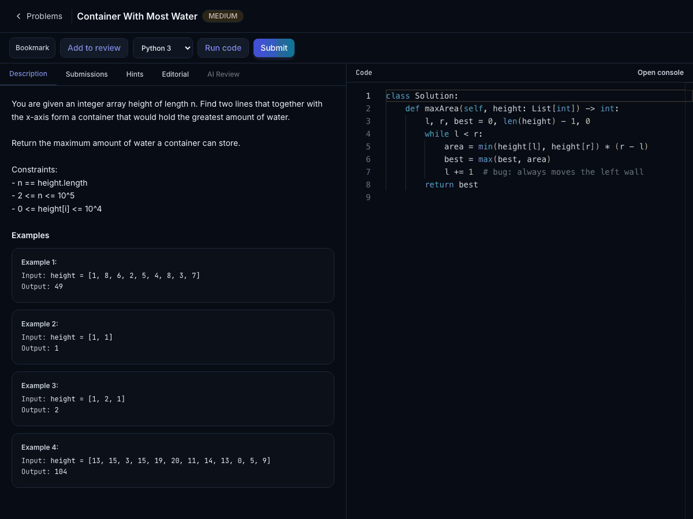
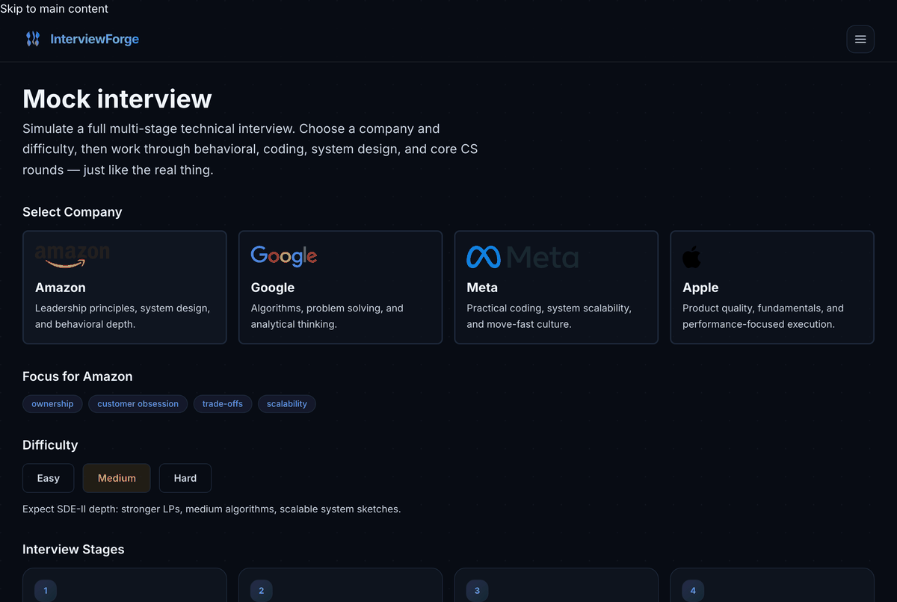

# 💻 InterviewForge

<div align="center">

**AI-powered mock interview platform — practice coding, system design, behavioral rounds, and timed assessments like the real thing.**

**Built around a measured RAG pipeline: retrieval quality is evaluated on a golden set, not asserted.**

[](https://github.com/Advait0801/InterviewForge/actions/workflows/ci.yml)

[](https://www.typescriptlang.org)
[](https://nextjs.org)
[](https://react.dev)
[](https://nodejs.org)
[](https://expressjs.com)
[](https://fastapi.tiangolo.com)
[](https://www.postgresql.org)
[](https://www.trychroma.com)
[](https://www.docker.com)
[](https://www.langchain.com)
[](https://ai.google.dev)

</div>

---

## 🎬 Demo

<div align="center">

**Sandboxed coding workspace — write, run, and get instant results**



**Resume-grounded mock interview — questions that reference your actual projects**



</div>

---

## 📱 Overview

**InterviewForge** simulates full technical interviews the way top companies run them. Pick a company (10 supported, from Amazon and Google to Microsoft, Uber and Bloomberg), choose a difficulty, and work through **behavioral → coding → system design → core CS** rounds — all powered by **RAG-backed LLM question generation**, with real-time evaluation and follow-ups.

On the coding side, work through **150 problems** (43 easy / 64 medium / 43 hard) in a **Monaco
editor** with code execution in **isolated Docker sandboxes** in seven languages (Python, C, C++,
Java, JavaScript, Go, Rust). Every problem is verified executable in all seven. Add your own test
cases, get **AI code reviews** checked against **measured time complexity**, follow an
**Elo-rated** next-problem pick, a daily problem and a **spaced-repetition** review queue, take
**proctored timed assessments**, or practise with a friend in a **peer mock interview**.

### 📈 Retrieval quality, measured

The RAG pipeline is evaluated against a hand-labelled golden set of 42 queries, so every
change is a number rather than an opinion. Full method and results in
[`docs/eval/`](docs/eval/); the reasoning behind each decision is in
[`docs/DECISIONS.md`](docs/DECISIONS.md).

| Metric | Before | After | |
|---|---|---|---|
| nDCG@5 | 0.771 | **0.901** | +0.130 |
| Hit rate@5 | 0.833 | **0.952** | +0.119 |
| MRR | 0.782 | **0.917** | +0.135 |
| p50 latency | 210 ms | **268 ms** | +58 ms |

What produced that, in order of contribution:

- **Per-stage query routing** — behavioural and system-design questions go through an LLM
  reranker; coding and core-CS questions go through hybrid BM25 + RRF, where precise
  terminology matters. Equal quality to reranking everything, at **6.6× lower p50 latency**.
- **Hybrid search with Reciprocal Rank Fusion** — dense retrieval is weak on rare exact
  tokens; BM25 is not. RRF fuses them on rank alone, so no score normalisation is needed.
- **Structural chunking** — splits on document structure instead of character counts, so a
  section is not cut mid-argument.
- **Small-to-big retrieval** — embeds small chunks for precision, returns the wider passage
  for context.

- **A retrieval cache** — repeated interview queries skip retrieval and the reranker's LLM
  call (13.6 s → 0.3 ms on the day it was measured). A semantic tier, calibrated on 126
  paraphrased queries with zero wrong-intent hits, is built but ships off: on today's traffic it
  would only merge difficulty levels ([`docs/eval/phase11.md`](docs/eval/phase11.md)).

**Two techniques were implemented, measured, and reverted** because the numbers said so:
contextual retrieval (it duplicates what structural chunking already provides) and MMR.
Those results are written up too — see [`docs/eval/phase2.md`](docs/eval/phase2.md) and
[`docs/eval/phase3.md`](docs/eval/phase3.md).

### ✨ Key Highlights

- 🎙️ **Multi-stage AI interviews** — Company-specific questions **streamed token by token** (SSE),
  follow-ups, voice evaluation, and downloadable PDF reports
- 🧭 **An interviewer with a personality and a budget** — four personas, a hint ladder that costs
  points, and an adaptive mode where an agent decides to probe, pivot or move on while the backend
  enforces the rules; every model call is metered per interview and capped
- 🔗 **Replay and share** — step through any interview as a timeline, or share it through a public
  link built by an allowlist serializer, so nothing private leaves the account
- 🔍 **Company-aware RAG** — Chroma vector store covering 10 companies, with retrieval
  filtered by company and interview stage
- 📐 **Evaluation harness** — golden-set retrieval metrics (nDCG, MRR, hit rate, recall) plus
  an LLM-judge calibration test that asserts weak < mediocre < strong answers
- 🌐 **Self-expanding corpus** — low-confidence retrieval triggers a live web fetch that is
  cleaned, deduplicated and **written back** to the vector store, so the first user to ask
  about a thin topic pays the latency and everyone after does not
- 💻 **Sandboxed code execution** — Run/submit user code in ephemeral Docker containers, never on the host
- 🔐 **Full auth system** — JWT tokens, bcrypt hashing, email verification, password reset,
  server-side session revocation (password change/reset and "sign out everywhere" end other sessions)
- 📊 **Practice ecosystem** — Problem bookmarks, filters, hints, editorials, submission history, streaks, heatmaps
- 🏆 **Leaderboard & analytics** — Global rankings, topic radar, difficulty distribution, acceptance trends
- 📋 **Timed assessments** — Multi-problem flows with a server-enforced deadline, scoring, and an
  integrity summary (tab switches, paste sizes, never pasted text) that never changes the score
- 🗺️ **Learning paths** — Curated problem sequences, plus a personal focus path built from your
  weakest topics
- 🔁 **Daily practice** — a deterministic Problem of the Day with streaks, and an SM-2 review queue
  that brings back problems you struggled with
- 🧱 **Bounded by design** — Redis-backed rate limits, a global cap on live sandboxes, and every
  dependency outage degrading to a retryable 503
- 📄 **Resume-grounded interviews** — an uploaded resume is parsed into a **per-user vector
  namespace** so questions reference the candidate's real projects; isolation is defended three
  independent ways and verified against a live stack (API-only, no upload UI yet)
- 🏗️ **System design** — AI-analyzed architecture explanations rendered as React Flow diagrams
- ♿ **Resilient, accessible UI** — every route distinguishes loading, empty, missing and error
  states with local recovery; keyboard focus, reduced-motion and light/dark theming throughout;
  verified by a scripted Chrome pass across widths and themes

---

## 🧩 Features

### Coding engine

- 150 problems with difficulty/topic/company/solved/saved filters and search
- Monaco-based code editor with syntax highlighting
- **Run** (the public example cases) and **Submit** (full suite, including hidden cases whose
  contents never leave the server; the first failing one is revealed for debugging)
- **Custom test cases** on Run, judged against the problem's reference solution, and a diff on
  every failing case showing where the output first goes wrong
- Submission history with language, status, runtime
- Progressive hints and editorials
- AI-powered code review (complexity, quality, optimizations)
- **Empirical complexity:** an accepted solution is timed inside the sandbox on inputs doubling
  in size, the growth class is fitted, and the result is checked against the AI reviewer's claim.
  Every O(n²) solution is named exactly in all seven languages, and O(n) vs O(n log n) is
  reported as "either" when memory effects make them inseparable
  ([`docs/eval/phase12.md`](docs/eval/phase12.md))
- **Elo-rated adaptive difficulty:** per-topic ratings from each first Submit pick the next
  problem at 65% predicted first-try success, which hits the target in simulation as well as an
  oracle that knows every user's true skill does
- Bookmarking and solved-state tracking
- Hand-curated company tags (3–5 per problem, from the 10 interview companies) driving
  "practice Amazon problems"-style filtering
- Every problem is verified in seven languages (Python, C, C++, Java, JavaScript, Go, Rust): a
  reference solution runs through the real sandbox against test cases whose expected outputs come
  from an independent brute-force oracle (`scripts/verify_problems.py`, `scripts/problemgen/`)

> The problems are the well-known ones from [LeetCode](https://leetcode.com): same numbers,
> titles and function signatures, credited here. Problem statements, hints and test cases are
> written independently in this repo rather than copied.

### AI interview simulator

- Choose one of **10 companies** (Amazon, Google, Meta, Apple, Microsoft, Uber, Bloomberg, Adobe,
  LinkedIn, Airbnb) and difficulty (**Easy / Medium / Hard**)
- 4-stage flow: Behavioral → Coding → System Design → Core CS
- RAG-retrieved context feeds the LLM for realistic, company-styled questions, streamed to the
  browser as they are generated; a turn is saved only once the whole question exists
- Real-time evaluation with follow-up questions
- Interviewer personas (neutral, friendly, terse, adversarial) and a three-rung hint ladder, each
  hint costing a point
- **Adaptive mode:** a model-driven interviewer chooses the next move inside rules the backend
  enforces; every interview's model spend is recorded and capped
- Replay any interview as a timeline, and share it through a revocable public link
- Voice recording → transcription → explanation scoring
- Session report with per-stage scores, strengths, weaknesses, recommendations — generated once
  and stored, so reopening it costs no model call
- **One-click PDF export** of the full report + transcript

### Peer mock interviews

- Invite a friend: one interviews, the other is the candidate; audio and video go peer to peer
  over WebRTC
- The backend relays only signalling (authenticated Socket.IO, allowlisted and rate limited), keeps
  a shared editor, runs the clock, and collects structured feedback from both sides afterwards
- Works across backend instances (Redis adapter) and through firewalls with expiring TURN
  credentials ([`docs/peer-interviews.md`](docs/peer-interviews.md))

### Platform

- Dashboard with stats, activity heatmap, Problem of the Day, Elo "next up" picks and
  AI-recommended problems
- Global leaderboard (problems solved, acceptance rate)
- Analytics page with charts (solved over time, difficulty pie, topic radar) and your ratings
- Structured learning paths with progress tracking, and a personal focus path from weak topics
- An SM-2 review queue, graded from your submissions
- Timed assessment mode with scoring and an integrity summary
- Real verification and password-reset email (Resend)
- Dark mode, responsive layouts, loading skeletons, error boundaries

---

## 🏗️ Architecture

```
┌────────────────┐                    ┌──────────────────┐        ┌────────────────┐
│                │     REST / WS      │                  │        │                │
│   Next.js      │ ◄────────────────► │  Express backend │ ◄────► │  PostgreSQL    │
│   :3000        │      /api/*        │  :4000           │        │                │
│                │                    │                  │        └────────────────┘
│                │                    │                  │        ┌────────────────┐
│                │                    │                  │ ◄────► │  Redis: limits,│
│                │                    │                  │        │  run queue,    │
│                │                    │                  │        │  cache         │
└────────────────┘                    └────────┬─────────┘        └────────────────┘
                                   REST │      │ REST
                          ┌─────────────┘      └──────────────┐
                          ▼                                   ▼
              ┌──────────────────┐                  ┌──────────────────┐
              │                  │  ┌────────────┐  │                  │
              │  FastAPI         │─►│  ChromaDB  │  │  code-runner     │
              │  ai-service      │  │ (RAG vecs) │  │  :5000           │
              │  :8000           │  └────────────┘  │                  │
              └────────┬─────────┘                  └────────┬─────────┘
                       │  Gemini / OpenAI                    │  Docker Engine API
                       ▼                                     ▼
              ┌──────────────────┐                  ┌──────────────────┐
              │  LLM +           │                  │  Docker sandboxes│
              │  embeddings APIs │                  │  (7 languages)   │
              └──────────────────┘                  └──────────────────┘
```
### 🔄 Data flow

1. **Auth** — Web client → Express (bcrypt + JWT) → PostgreSQL `users`
2. **Code submit** — Web client → Express → BullMQ queue (Redis; at most `CODE_RUN_CONCURRENCY` runs at once) → code-runner → ephemeral Docker container → test results → response
3. **Interview question** — Express → FastAPI → Chroma retrieval (behind a Redis retrieval cache) + LLM chain → streamed over SSE to the browser → stored in `interview_messages` once complete
4. **Peer interview** — browser ↔ Socket.IO `/peer` on Express (signalling, shared code, clock) ↔ the other browser; audio and video go peer to peer over WebRTC
5. **RAG pipeline** — Seed documents → chunking → embeddings → Chroma → filtered retrieval by company + stage + difficulty calibration

---

## 🛠️ Tech Stack

### Frontend (Web)

| | |
|---|---|
| **Framework** | Next.js 16 (App Router), React 19, TypeScript 5 |
| **Styling** | Tailwind CSS 4, Framer Motion animations |
| **Editor** | Monaco Editor (`@monaco-editor/react`) |
| **Diagrams** | React Flow (`@xyflow/react`) |
| **Charts** | Recharts |
| **Realtime** | Socket.IO client |
| **Utilities** | Sonner (toasts), jsPDF (report export) |

### Backend (Node.js)

| | |
|---|---|
| **Framework** | Express 5, TypeScript |
| **Auth** | JWT (`jsonwebtoken`), bcrypt |
| **Database** | PostgreSQL via `pg` |
| **Realtime** | Socket.IO (`/peer` namespace, Redis adapter for multiple instances) |
| **Security** | `helmet`, CORS, per-user API rate limits + per-IP login/sign-up limits (`express-rate-limit`), revocable sessions (`token_version`), fail-closed `JWT_SECRET` |

### AI Service (Python)

| | |
|---|---|
| **Framework** | FastAPI, Uvicorn |
| **LLM** | Gemini 3.1 Flash Lite (primary), GPT-4o-mini (fallback), set via `GEMINI_MODEL` / `OPENAI_MODEL` |
| **RAG** | LangChain + ChromaDB, hybrid BM25 + RRF, LLM reranking, per-stage routing |
| **Evaluation** | Golden-set harness (nDCG / MRR / hit rate), LLM-judge calibration, context-sufficiency rubric |
| **Embeddings** | OpenAI `text-embedding-3-small` (default, chosen for bulk-ingestion throughput); Gemini `gemini-embedding-001` supported |

### Execution & Data

| | |
|---|---|
| **Code runner** | Node.js service using Docker Engine API |
| **Sandboxes** | Per-language images in `docker/sandboxes/` (python, c, cpp, java, javascript, go, rust), unprivileged and resource-capped |
| **Database** | PostgreSQL 16 — 21 raw-SQL migrations covering users, problems, submissions, interviews, assessments, paths, bookmarks, resumes, indexes, session revocation, interview cost, learning features, sharing and proctoring, complexity, Elo and peer sessions |
| **Vector store** | ChromaDB 0.5.5 |
| **Shared state** | Redis 7: rate-limit counters (backend and the ai-service's live-fetch limits), the BullMQ code-run queue with a global concurrency cap, the leaderboard cache, and the bounded retrieval cache |
| **Orchestration** | Docker Compose (7 services) |

---

## 📂 Repository Layout

```
InterviewForge/
├── web/                    # Next.js frontend
│   └── src/app/            # App Router pages (dashboard, problems, interview, etc.)
├── backend/                # Express API server
│   ├── src/routes/         # HTTP only: parse, validate, call a service, map errors
│   ├── src/services/       # business rules; ai.service (REST client for ai-service), code-runner client
│   ├── src/repositories/   # all SQL, one file per table group
│   ├── src/realtime/       # Socket.IO /peer: signalling relay, presence, shared code (no SQL)
│   ├── openapi/            # openapi.yaml, the API contract every route test is checked against
│   ├── src/__tests__/      # unit + route-level tests; helpers/ holds the HTTP harness and fake Postgres
│   ├── sql_migrations/     # 001_init.sql through 021_peer_sessions.sql
│   ├── reference_solutions/# <slug>/solution.{py,c,cpp,java,js,go,rs} — every problem, every language
│   └── scripts/            # seed_problems.ts, seed_learning_paths.ts
├── ai-service/             # FastAPI AI backend
│   ├── app/api/            # RAG, interview, code-review, speech, recommendations
│   ├── app/interview/      # Company profiles, orchestrator, the adaptive interviewer agent
│   ├── app/llm/            # LLM chains (question, evaluation, report, etc.)
│   ├── app/rag/            # Chroma client, chunking, embeddings, service, retrieval cache
│   ├── app/resume/         # PDF parsing and per-user vector namespaces
│   ├── seed_data/          # documents.json (RAG corpus)
│   └── scripts/            # seed_rag.py
├── code-runner/            # Sandbox orchestration service
├── docker/sandboxes/       # Sandbox Dockerfiles (python, c, cpp, java, javascript, go, rust)
├── scripts/                # verify_*.py (live-stack checks), problemgen/ (specs + oracles),
│                           # ci/smoke_prod_images.sh
├── .github/workflows/      # ci.yml: lint, tests, builds, prod-image smoke tests
├── docs/                   # DECISIONS, BACKLOG, PROJECT_CONTEXT, peer-interviews, eval/, audits/, ui-ux/
├── docker-compose.yml      # Local development stack
└── docker-compose.prod.yml # Production stack (AWS)
```

Each service reads its own `.env` (gitignored); every one has a committed `.env.example` template.

---

## 🚀 Getting Started

### Prerequisites

- **Docker** + **Docker Compose**
- API keys for **Gemini** and/or **OpenAI** (for the ai-service)

### Setup

```bash
# 1. Clone the repo
git clone https://github.com/Advait0801/InterviewForge.git
cd InterviewForge

# 2. Copy the environment templates and fill them in
cp .env.postgres.example .env.postgres
cp backend/.env.example backend/.env
cp ai-service/.env.example ai-service/.env
cp web/.env.example web/.env
cp code-runner/.env.example code-runner/.env
#    - backend/.env: set JWT_SECRET (>= 32 chars, e.g. `openssl rand -hex 32`);
#      the backend refuses to start without one. Keep the DATABASE_URL password
#      in step with POSTGRES_PASSWORD in .env.postgres.
#    - ai-service/.env: add GEMINI_API_KEY and/or OPENAI_API_KEY.

# 3. Build the code-execution sandboxes (code-runner starts one per run)
for lang in python c cpp java javascript go rust; do
  docker build -t interviewforge-$lang-sandbox:latest docker/sandboxes/$lang-sandbox/
done

# 4. Start everything
docker compose up --build
```

### Access

> Host ports are deliberately offset (3002, 8010, 5433) so the stack can run
> alongside other local projects. Services address each other over the compose
> network on their container ports, so these mappings affect only the host.

| Service | URL |
|---------|-----|
| Web app | http://localhost:3002 |
| Backend API | http://localhost:4000 |
| AI service | http://localhost:8010 |
| Code runner | http://localhost:5050 |

### Database setup

```bash
# Apply all migrations in order
for f in $(ls backend/sql_migrations/*.sql | sort); do
  docker compose exec -T postgres psql -U postgres -d interviewforge -f - < "$f"
done

# Seed coding problems and learning paths
docker compose exec backend npx ts-node scripts/seed_problems.ts
docker compose exec backend npx ts-node scripts/seed_learning_paths.ts

# Seed RAG knowledge base
docker compose exec ai-service python scripts/seed_rag.py

# Expand the corpus from curated engineering-blog feeds
docker compose exec ai-service python -m app.ingest.batch --limit 4
```

### Running the evaluation

```bash
# Retrieval metrics against the 42-query golden set (no LLM calls, so this is free)
docker compose exec ai-service python -m app.eval.run --k 5 --no-filter

# Judge calibration: asserts weak < mediocre < strong for the same question
docker compose exec ai-service python -m app.eval.monotonicity --replay app/eval/fixtures/monotonicity.json

# Retrieval cache: threshold sweep and quality/latency replay (--mode dense makes no LLM calls)
docker compose exec ai-service python -m app.eval.semantic_cache --mode dense

# Elo picker: realised first-try success against an oracle and baselines (pure simulation, free)
cd backend && npx ts-node scripts/simulate_elo.ts && cd ..

# Context sufficiency (uses an LLM judge, so this one costs money)
docker compose exec ai-service python -m app.eval.sufficiency --window 0 --window 1
```

### Tests

```bash
cd backend      && npm test    # Vitest: unit + route-level tests over a strict fake Postgres
cd web          && npm test    # Vitest + Testing Library
cd code-runner  && npm test    # Vitest
docker compose exec ai-service python -m pytest

# Against the running stack (CLAUDE.md lists them all; those marked $ make a few cheap model calls)
python scripts/verify_problems.py          # every problem x 7 languages through the real sandbox (1,050 cells)
python scripts/verify_coding_engine.py     # custom test cases, failing-case diffs, all 7 languages
python scripts/verify_phase7.py            # problems, filters, editorials, stats, streaks
python scripts/verify_learning.py          # Problem of the Day, SM-2 review queue, personal paths
python scripts/verify_sharing.py           # replay, public links leak nothing, proctoring
python scripts/verify_complexity.py        # empirical complexity on known solutions, 7 languages
python scripts/verify_elo.py               # rated first Submits, racing pairs
cd backend && npx ts-node scripts/verify_peer.ts && cd ..   # peer invites, room auth, relay, clock
python scripts/verify_streaming.py         # $ SSE interview streams, disconnects, double submits
python scripts/verify_interviewer.py       # $ personas, hint ladder and its penalty
python scripts/verify_agent.py             # $ adaptive interviewer rules and cost
python scripts/verify_retrieval_cache.py   # $ cache hits, invalidation, Redis outage
python scripts/verify_resume_isolation.py  # $ cross-user resume isolation and deletion
python scripts/load_test_run_queue.py --requests 20 --cap 4   # the live-sandbox cap holds

# Production images: build each Dockerfile.prod tagged :ci first (see the script header)
bash scripts/ci/smoke_prod_images.sh
```

CI (`.github/workflows/ci.yml`) runs lint, typecheck, tests and builds for every service, checks
that the generated API types match both OpenAPI specs, builds all four production images and the
seven sandboxes, and smoke-tests the production images: no `.env` baked in, required data files
present, each image boots and answers its health check.

---

## 🔄 How It Works

### 1. Sign up / Log in

Register with username, email, and password. Express hashes with **bcrypt**, returns a **JWT**. Email verification and password reset flows are built in. All protected routes require `Authorization: Bearer <token>`. Tokens carry a version that the backend checks on every request, so a password change or reset — or **Sign out everywhere** in Settings — ends other sessions immediately; the web app then returns to login.

### 2. Solve coding problems

Browse the problem list with filters (difficulty, topic, company, solved status, search), or take the Problem of the Day or an Elo pick from the dashboard. Open a problem → write code in the **Monaco editor** → **Run** against the example cases and your own → **Submit** to run the full suite, hidden cases included. Code executes inside an **isolated Docker container** — never on the host. A first Submit moves your rating; an accepted one can be **timed on growing inputs** to measure its complexity, and compared with an **AI code review**'s claim.

### 3. Take a mock interview

Select one of the **10 companies** and a difficulty level. The platform creates a session and generates the first question using **RAG retrieval** from the company's interview knowledge base + **LLM generation** with company-specific style and difficulty calibration.

Pick an interviewer tone and a mode (classic, or adaptive). Work through **4 stages**: Behavioral → Coding → System Design → Core CS, with questions streaming in as they are written. Each answer is evaluated; follow-up questions dig deeper, and hints are there at a price. On completion, generate a **full report** with per-stage scores, download it as a **PDF**, replay the interview, or share it through a link you can revoke.

Or practise with a person: host a **peer interview**, send the one-time invite link, and take the interviewer or candidate seat with a shared editor, a server-kept clock, optional audio and video, and feedback for each other at the end.

### 4. Track your progress

The **dashboard** shows solve stats, the Problem of the Day and your streak, your next Elo picks, and an activity heatmap. **Analytics** breaks down your performance by difficulty, topic, acceptance rate and rating over time. The **review queue** brings back problems at SM-2 intervals. The **leaderboard** ranks users globally. **Learning paths** give structured problem sequences to follow, including one built from your weakest topics.

---

## ☁️ AWS Deployment

InterviewForge **was deployed on AWS Free Tier** with the setup below. The environment
has since been torn down (free tier expired), so there is no live instance today —
but `docker-compose.prod.yml` and the `Dockerfile.prod` files are accurate and the
stack is redeployable as documented.

### Infrastructure

| Resource | Spec |
|----------|------|
| **EC2** | `t3.micro` (1 vCPU, 1 GB RAM + 2 GB swap), Amazon Linux 2023, 30 GB gp3 |
| **RDS** | `db.t3.micro`, PostgreSQL 16, 20 GB gp2 (private subnet) |
| **Networking** | Elastic IP, Nginx reverse proxy, security groups restricting DB access to EC2 only |

### Production stack

The production setup uses `docker-compose.prod.yml` with multi-stage `Dockerfile.prod` files for each service:

- **Compiled builds** — TypeScript compiled to JS, Next.js pre-built, no hot-reload
- **Multi-stage images** — dev dependencies stripped from final images
- **Memory limits** — backend 200m, ai-service 300m, code-runner 150m, web 250m, chromadb 200m, redis 64m
- **Restart policies** — `unless-stopped` on all containers
- **Localhost-bound ports** — Nginx handles all public traffic on port 80

### Deploy from scratch

```bash
# SSH into EC2
ssh -i interviewforge-key.pem ec2-user@<ELASTIC_IP>

# Clone and configure
git clone <repo-url> ~/InterviewForge && cd ~/InterviewForge
# Create .env files for each service (backend, ai-service, code-runner, web)
# backend/.env needs JWT_SECRET (>= 32 chars; the backend refuses to boot otherwise),
# and EMAIL_PROVIDER=resend with RESEND_API_KEY (and EMAIL_FROM on a verified domain) so
# verification and reset emails are sent (the default, log, only prints them).
# Set TRUST_PROXY=1 too, since Nginx sits in front and rate limits key on client IP

# Build sandbox images
for lang in python c cpp java javascript go rust; do
  docker build -t interviewforge-$lang-sandbox:latest docker/sandboxes/$lang-sandbox/
done

# Start all services
docker compose -f docker-compose.prod.yml up -d --build

# Run migrations against RDS
for f in $(ls backend/sql_migrations/*.sql | sort); do
  PGPASSWORD='<pass>' psql -h <RDS_ENDPOINT> -U postgres -d interviewforge -f "$f"
done

# Seed data (the prod image ships compiled dist/ only, hence the one-off ts-node)
docker compose -f docker-compose.prod.yml exec backend sh -c \
  "npm install -g ts-node typescript @types/node && \
   ln -s /app/dist /app/src 2>/dev/null; \
   ts-node --skip-project --compiler-options '{\"module\":\"commonjs\"}' scripts/seed_problems.ts && \
   ts-node --skip-project --compiler-options '{\"module\":\"commonjs\"}' scripts/seed_learning_paths.ts"
docker compose -f docker-compose.prod.yml exec ai-service python scripts/seed_rag.py
```

### Update after code changes

```bash
cd ~/InterviewForge && git pull origin main
# Apply any migrations added since the last deploy (each is idempotent), then rebuild
for f in $(ls backend/sql_migrations/*.sql | sort); do
  PGPASSWORD='<pass>' psql -h <RDS_ENDPOINT> -U postgres -d interviewforge -f "$f"
done
docker compose -f docker-compose.prod.yml up -d --build
```

> Upgrading from before migration 013: every existing login token stops working once, and
> users sign in again (tokens now carry a revocation version).

---

## 🚧 Roadmap

- [x] Production Docker Compose with multi-stage builds
- [x] AWS deployment (EC2 + RDS + Nginx)
- [x] CI pipeline (lint, typecheck, test, build) across all four services, plus production-image
      builds and smoke tests
- [x] Test suites — 2,052 tests: 689 `backend` (route-level tests over a strict fake Postgres,
      every response checked against the OpenAPI contract), 586 `ai-service`, 444 `code-runner`,
      333 `web`
- [x] RAG evaluation harness with a committed baseline
- [x] Retrieval quality work: structural chunking, hybrid search, reranking, routing
- [x] Live corpus ingestion with provenance and write-back caching
- [x] Expanded from 4 to 10 company interview profiles
- [x] Sandbox hardening (non-root, `CapDrop: ALL`, `no-new-privileges`, `PidsLimit`, CPU quota),
      each control proven adversarially
- [x] Resume-grounded personalised interviews with per-user vector isolation
- [x] Problem set expanded 42 → 150, all verified executable in seven languages (1,050 cells)
- [x] UI/UX pass across every core workflow — honest resource states, responsive panes,
      accessible analytics, route-level error recovery
- [x] End-to-end verification, twice: correctness and resilience rounds from a clean boot
      (Sep and Oct 2026); dependency outages degrade to retryable 503s, hostile input to 4xx
- [x] Backend hardening — fail-closed JWT secret, per-user and auth rate limits, `helmet`, query
      indexes, session revocation, transactional multi-write routes, server-enforced assessment
      deadline, hidden test cases kept server-side
- [x] Layered backend (routes → services → repositories, enforced by a test) and an OpenAPI
      contract with generated clients for both APIs
- [x] Redis: shared rate limits, a BullMQ code-run queue with a global sandbox cap, caches
- [x] Streaming interview questions (SSE), interviewer personas, a hint ladder, and an adaptive
      agent mode with per-interview cost accounting and a cap
- [x] Custom test cases, failing-case diffs, and JavaScript, Go and Rust
- [x] Problem of the Day, SM-2 review queue, personal learning paths
- [x] Interview session replay, public share links, assessment proctoring
- [x] Real verification and password-reset email
- [x] A retrieval cache, empirical complexity measurement, and Elo-rated adaptive difficulty
- [x] Peer mock interviews: WebRTC between two users, with Socket.IO signalling, a shared editor,
      a server-side clock and feedback
- [ ] HTTPS via Let's Encrypt (requires domain)
- [ ] Horizontal scaling for code-runner and ai-service (the backend already runs as several
      instances: limits, the run queue and Socket.IO share state through Redis)
- [ ] Offline resilience beyond the peer room's reconnect
- [ ] User profile customization and social features

The fuller version, with effort and impact estimates, is in [`docs/BACKLOG.md`](docs/BACKLOG.md).

---

## 📚 Documentation

| Doc | What it covers |
|---|---|
| [`docs/DECISIONS.md`](docs/DECISIONS.md) | Append-only log of every non-obvious decision and finding, with the reasoning (D-001 … D-080) |
| [`docs/BACKLOG.md`](docs/BACKLOG.md) | What is deliberately not built yet, with effort and impact estimates |
| [`docs/eval/`](docs/eval/) | Retrieval baselines and per-phase results (retrieval, the retrieval cache, complexity, Elo), including the negative ones |
| [`docs/peer-interviews.md`](docs/peer-interviews.md) | Peer mock interviews: the flow, the Socket.IO protocol, deploying with Nginx and TURN |
| [`docs/audits/`](docs/audits/) | Investigations with their evidence: homepage performance, accessibility, microphone error paths |
| [`docs/ui-ux/`](docs/ui-ux/) | UI phase reports, route/state matrix, and re-runnable browser capture scripts |
| [`docs/PROJECT_CONTEXT.md`](docs/PROJECT_CONTEXT.md) | Original product spec and long-term vision |

---

## 🙏 Acknowledgments

- [**Google Gemini**](https://ai.google.dev) & [**OpenAI**](https://openai.com) — LLM and embedding APIs
- [**ChromaDB**](https://www.trychroma.com) — Vector storage for RAG
- [**LangChain**](https://www.langchain.com) — LLM orchestration framework
- [**Next.js**](https://nextjs.org), [**Express**](https://expressjs.com), [**FastAPI**](https://fastapi.tiangolo.com) — Core frameworks
- The open-source community behind every dependency in this stack

---

<div align="center">

**Built with ❤️ using TypeScript, Python, Next.js, Express, FastAPI, and Docker**

⭐ Star this repo if you find it helpful!

</div>
